# Mermaid rendering suite

## block

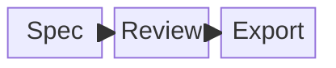

## class

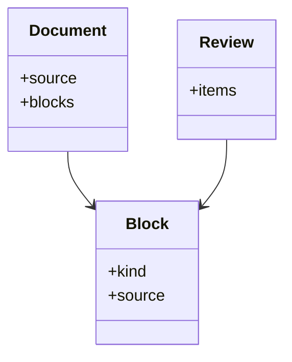

## er

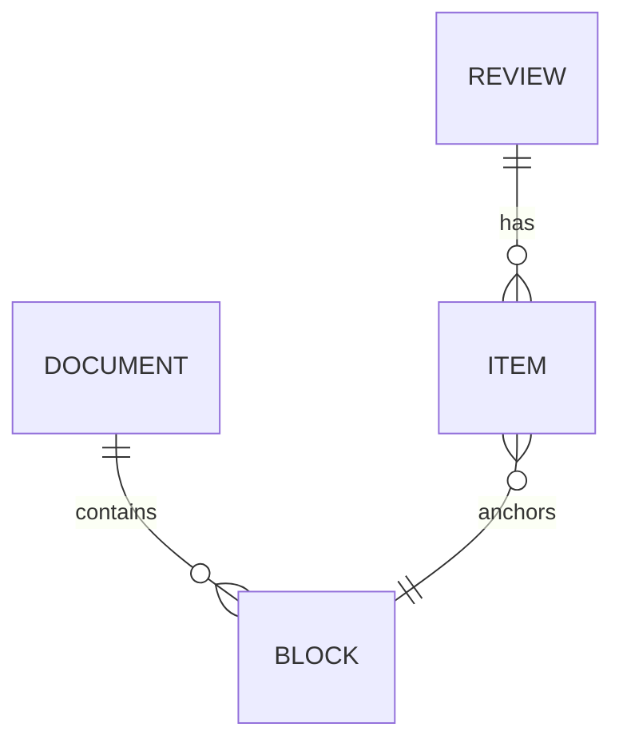

## flowchart_lr_small

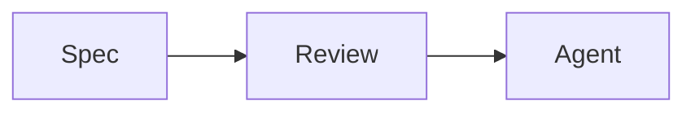

## flowchart_lr_wide

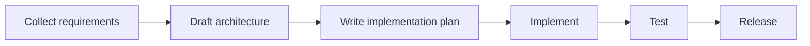

## flowchart_nested

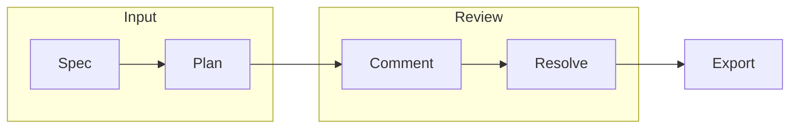

## flowchart_td_tall

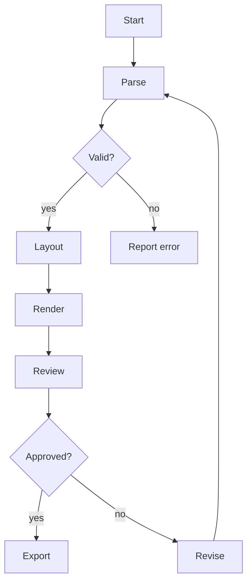

## gantt

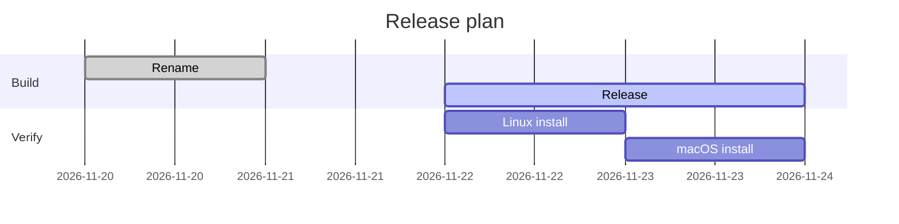

## gitgraph

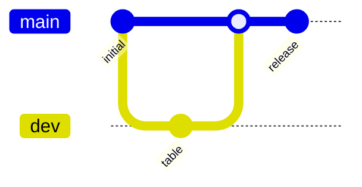

## mindmap

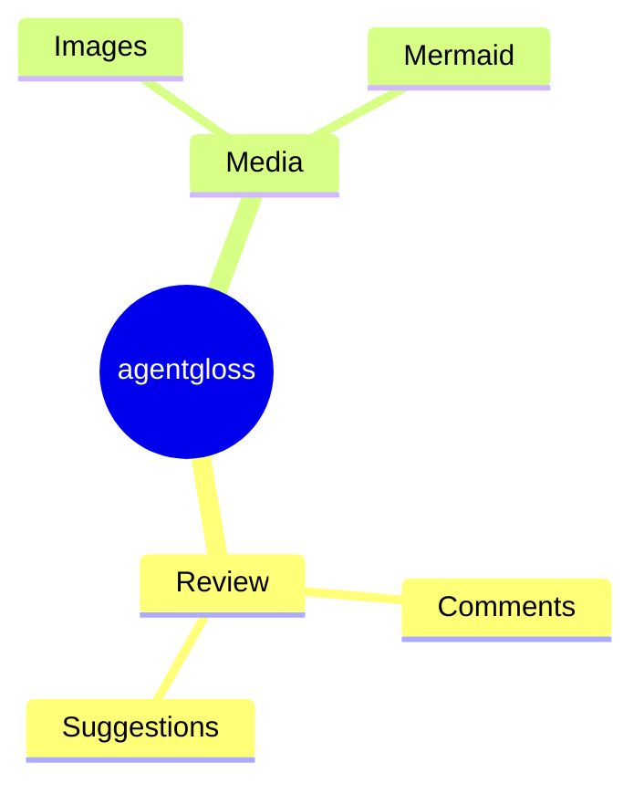

## pie

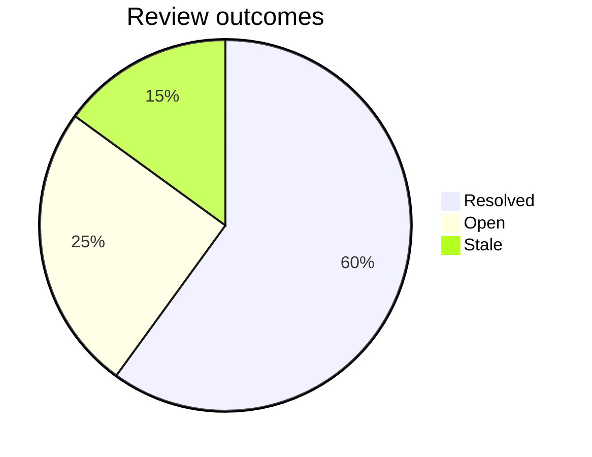

## sequence

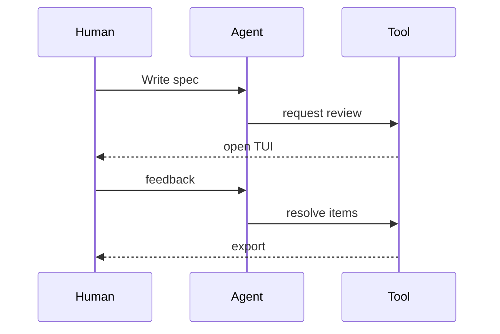

## sequence_tall

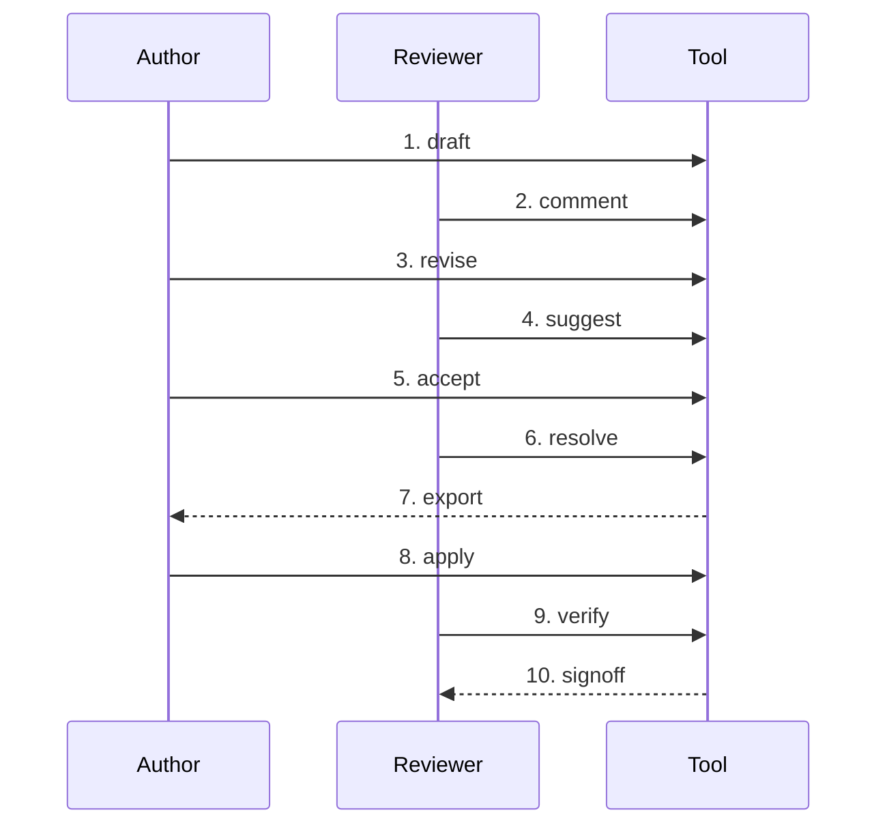

## state

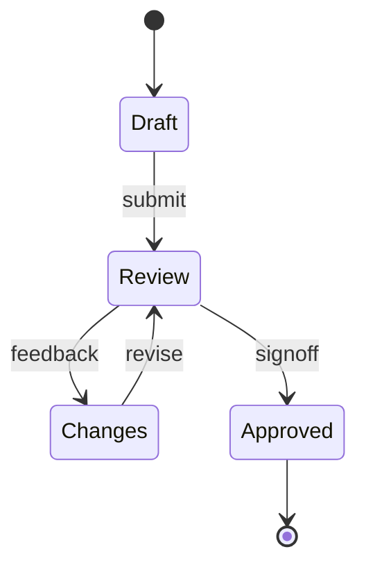

## timeline

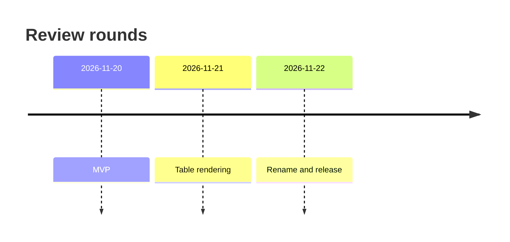

## unicode_long_labels

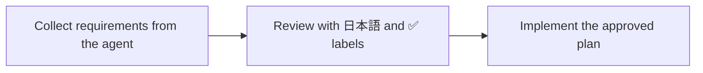
