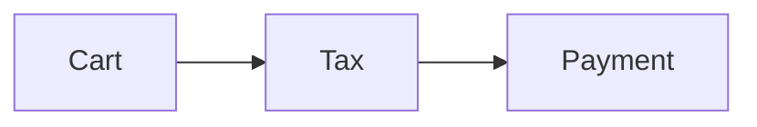

# Checkout spec

A short fixture for manual and PTY validation.

## Flow

The checkout flow validates the cart, calculates tax, and creates a payment intent.

- Retry failed payments
- Surface a clear error

## Diagram

| Step | Owner |
| --- | --- |
| Cart | Web |
| Tax | Payments |
